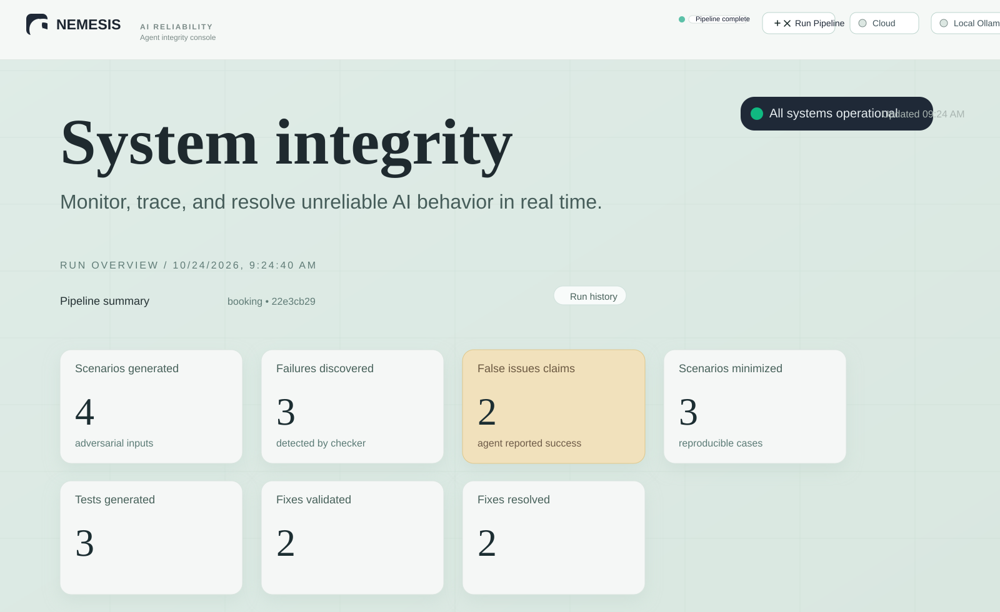

# NEMESIS

**An agentic AI security platform for stress-testing LLM behavior, exposing unsupported claims, and strengthening defenses—with the freedom to run inference locally.**

[](https://www.python.org/)
[](https://react.dev/)
[](https://fastapi.tiangolo.com/)

## What is NEMESIS?
<p align="center">
  
</p>

NEMESIS is an agentic AI security and LLMOps platform built to make language-model behavior more observable, testable, and resilient. It orchestrates AI agents to inspect failure evidence, propose defensive instruction improvements, and independently adjudicate those proposals against supplied regression cases.

By connecting model-driven red teaming with claim-level evidence and privacy-aware inference, NEMESIS gives teams a practical way to examine not only what an AI system answered, but whether the answer was supported by the observed execution. Its multi-agent workflow keeps the Fixer and Red Team roles distinct, while human-readable traces make the review process easier to inspect.

## Key features

- **Agentic red-team workflow:** Coordinate a Fixer agent and a distinct Red Team adjudicator. The Fixer proposes an improved instruction; the Red Team evaluates it against the selected failure evidence and supplied regression cases.
- **Multi-model adjudication:** Route the Fixer and Red Team to separately configured Groq models, adding a second model perspective to defensive review.
- **Local-first LLM inference:** Switch to Ollama to keep inference on the local machine. Local mode requires a loopback endpoint and does not fall back to Groq.
- **Claim-level AI accountability:** Generate timestamped, exportable audit entries that isolate unsupported claims and describe their divergence from expected behavior.
- **Hallucination and claim diffing:** Inspect the original AI output beside the corrected response and ground truth to see precisely where a claim overreached.
- **Evidence-grounded LLM diagnostics:** Ask questions about pipeline behavior and receive answers that cite matching values from the supplied execution evidence.
- **Flexible inference modes:** Use Groq (`live_llm`), Ollama (`local_llm`), or deterministic offline execution (`mock_llm`).

Agent review is model adjudication against supplied cases—not execution of tests, proof of correctness, or automatic modification of a deployed agent.
<p align="center">
  
</p>
## Tech stack

| Capability | Technology |
| --- | --- |
| Agent and LLM orchestration | Python, LiteLLM, Pydantic |
| Multi-model adjudication | Groq API with separately configured Fixer and Red Team models |
| Private local inference | Ollama, restricted to a loopback endpoint |
| AI security evidence and run records | FastAPI, SQLite, SQLAlchemy |
| Interactive review workbench | React, Vite, Tailwind CSS |

## Quick start

### Prerequisites

- Python 3.11 or newer
- Node.js and npm
- For cloud inference: a Groq API key and access to the configured models
- For local inference: Ollama installed with the configured model available

### 1. Clone the repository

```powershell
git clone https://github.com/Darshika140/NEMESIS.git
cd NEMESIS
```

### 2. Install backend dependencies

From the repository root:

```powershell
py -3.13 -m venv .venv
.\.venv\Scripts\Activate.ps1
python -m pip install --upgrade pip
python -m pip install -e ".[dev]"
```

If PowerShell blocks activation, either allow it for the current terminal with `Set-ExecutionPolicy -Scope Process -ExecutionPolicy Bypass`, or use the virtual environment's interpreter directly:

```powershell
.\.venv\Scripts\python.exe -m pip install -e ".[dev]"
```

### 3. Configure inference

Create the backend environment file:

```powershell
Copy-Item .secrets\.env.example .secrets\.env
```

For **Groq**, set `GROQ_API_KEY` in `.secrets\.env`. The example file also contains separate Fixer and Red Team model settings; use model IDs available to your Groq account.

For **Ollama**, install/start Ollama and ensure the configured model exists. Check available models with:

```powershell
ollama list
```

The example defaults to `gemma4:e2b`. If needed, download it with `ollama pull gemma4:e2b`. Ollama may already be running in the background; if port `11434` is occupied, check that the Ollama service is available rather than starting a second server.

You can also use `mock_llm` mode for an offline smoke test without configuring either provider.

### 4. Start the backend

In a terminal at the repository root:

```powershell
.\.venv\Scripts\python.exe -m uvicorn nemesis.api.main:app --reload
```

The API is available at `http://127.0.0.1:8000`; interactive API documentation is at `http://127.0.0.1:8000/docs`.

### 5. Install and start the frontend

In a second terminal:

```powershell
cd frontend
npm install
Copy-Item .env.example .env
npm run dev
```

Open the Vite URL printed in the terminal, usually `http://localhost:5173`. The frontend's `.env.example` points to the default backend at `http://127.0.0.1:8000`.

### 6. Run a quick check

From the repository root, run the tests:

```powershell
.\.venv\Scripts\python.exe -m pytest -q
```

To create a deterministic run without calling an LLM, send a request to the API in another terminal:

```powershell
Invoke-RestMethod -Method Post `
  -Uri http://127.0.0.1:8000/api/run `
  -ContentType "application/json" `
  -Body '{"mode":"mock_llm","n_scenarios":1}'
```

## Agentic AI architecture

1. NEMESIS runs an AI-agent scenario through a configured inference provider and captures its observable outputs and verification evidence.
2. The orchestration layer identifies failure signals—including unsupported success claims—and makes the corresponding run and scenario evidence available for review.
3. In the Agent Boardroom, the **Fixer** proposes a focused instruction improvement. A distinct **Red Team adjudicator** reviews the proposal against the supplied evidence and regression cases, with each turn streamed to the review interface.
4. The **evidence and audit layer** validates diagnostic citations against the supplied run data and turns recorded claim divergences into exportable compliance entries.
5. The **inference gateway** routes requests either to configured Groq models or to local Ollama. Local mode is restricted to loopback and has no cloud fallback; mock mode supports deterministic runs without model calls.

The React interface is the inspection surface for this workflow; the core value is the agentic evaluation loop, grounded evidence, and choice of inference boundary.

## Why NEMESIS matters

An AI agent can confidently announce success even when its tools show that an operation is still pending or has failed. NEMESIS brings that reliability gap into view: it captures the execution evidence, highlights the unsupported claim, invites a Fixer to propose a targeted defense, and asks a separate Red Team model to challenge that proposal against the supplied cases.

With a local Ollama route alongside cloud inference, NEMESIS also makes privacy a first-class part of the LLM workflow. The result is a compelling foundation for teams that want clearer AI failure analysis, more rigorous instruction review, and greater control over where model inference runs.

## Project status

NEMESIS brings together agentic orchestration, multi-model evaluation, auditable evidence, and privacy-aware inference in one cohesive AI security workbench. The project does not currently declare an open-source license or configure a CI workflow.
